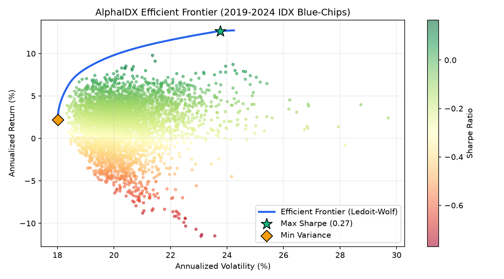
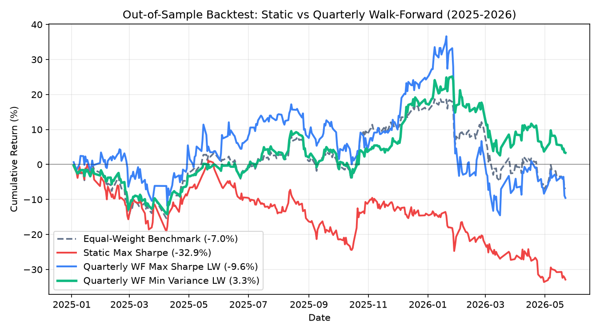

# AlphaIDX: Quantitative Portfolio Optimization & Risk Engine


## Executive Summary
AlphaIDX is a quantitative finance engine built for Indonesia Stock Exchange (IDX) blue-chip equities. It pairs **Modern Portfolio Theory (Markowitz MPT)** and **Ledoit-Wolf covariance shrinkage** with **Geometric Brownian Motion (GBM)** Monte Carlo risk projections using Itô drift correction and antithetic variates.

To address standard mean-variance estimation sensitivity, the engine includes **Risk Parity**, the **Black-Litterman** model (solved via the Woodbury identity), **GARCH(1,1)** conditional volatility forecasting, L1 turnover transaction cost penalties, and rolling **walk-forward out-of-sample backtesting**. All capabilities are exposed through a non-interactive CLI, an interactive Streamlit web app, and five research notebooks.

## Visual Output Preview




## Empirical Results (10 IDX Blue-Chips)

### In-Sample Optimization & 1Y Risk Projection (2019-01-01 to 2024-12-31, Sample Covariance)

| Metric | Max Sharpe Portfolio | Min Variance Portfolio |
|--------|----------------------|------------------------|
| Annualized Return | 12.67% | 2.37% |
| Annualized Volatility | 23.68% | 18.17% |
| Sharpe Ratio ($R_f = 6.25\%$) | 0.27 | -0.21 |
| 1Y Monte Carlo VaR (95%) | 25.38% | 25.41% |
| 1Y Monte Carlo CVaR (95%) | 32.23% | 30.75% |
| In-Sample Max Drawdown | -36.15% | -36.01% |

### Out-of-Sample Backtest (2025-01-01 to 2026-05-25, 10 bps Rebalance Cost)

| Strategy | Realized Return | Realized Volatility | Realized Sharpe | Max Drawdown | Cumulative Return |
|----------|-----------------|---------------------|-----------------|--------------|-------------------|
| Static Max Sharpe (Sample) | -31.78% | 28.64% | -1.33 | -34.94% | -33.54% |
| Static Min Variance (Sample) | -15.07% | 21.92% | -0.97 | -23.66% | -17.62% |
| Quarterly Walk-Forward Max Sharpe (Ledoit-Wolf) | -7.82% | 36.80% | -0.38 | -37.45% | -9.57% |
| **Quarterly Walk-Forward Min Variance (Ledoit-Wolf)** | **+2.55%** | **22.37%** | **-0.17** | **-18.03%** | **+3.33%** |
| Equal-Weight Benchmark | - | - | - | - | -6.98% |

*Why Walk-Forward Min Variance outperformed:* During the 2025–2026 sector rotation (when 2019–2024 leaders `BBCA.JK`/`BMRI.JK` fell `-35.5%`/`-13.9%` while `EXCL.JK`/`ASII.JK` rallied `+34.7%`/`+24.5%`), historical mean-return chasing (`Max Sharpe`) broke down. Dropping noisy mean estimates and rebalancing quarterly (`63` trading days) using `Ledoit-Wolf` covariance shrinkage delivered **+3.33%** cumulative return (**+10.31%** above the equal-weight benchmark) with `-18.03%` max drawdown.

## Mathematical Foundation

### 1. Portfolio Metrics
Expected return and variance are computed via vectorized matrix operations:
```text
E[R_p] = w^T · μ
σ²_p   = w^T · Σ · w
S      = (E[R_p] - R_f) / σ_p
```

### 2. Efficient Frontier & Covariance Shrinkage
The optimizer solves constrained quadratic programming using warm-started `SLSQP`, supporting both sample covariance and analytical Ledoit-Wolf shrinkage toward a scaled identity target:
```text
Minimize:   w^T · Σ · w
Subject to: Σ w_i = 1,  w_i >= 0 (or -0.5 <= w_i <= 1.0 when shorting enabled),  w^T · μ = μ_target
```

### 3. Stochastic Projection (GBM with Itô Correction & Antithetic Variates)
Price trajectories incorporate the Itô drift adjustment and paired $(Z, -Z)$ antithetic draws:
```text
ln(S_t / S_0) = (μ - 0.5σ²) · t + σ · W_t
```

## Project Structure
```text
AlphaIDX/
├── .github/workflows/
│   └── ci.yml                       # Ruff, Black, pytest, and CLI smoke tests (Python 3.11 & 3.12)
├── assets/                          # Empirical chart previews
├── notebooks/
│   ├── 01_data_and_eda.ipynb        # Market context, fat tails & sector correlations
│   ├── 02_optimization.ipynb        # Markowitz MPT & Efficient Frontier
│   ├── 03_monte_carlo.ipynb         # GBM stochastic projection & 1Y VaR/CVaR
│   ├── 04_backtesting.ipynb         # Out-of-Sample validation
│   └── 05_advanced_allocations.ipynb# Risk Parity & Black-Litterman models
├── src/
│   ├── cli.py                       # Non-interactive CLI (`python -m src.cli` / `alphaidx`)
│   ├── live_dashboard.py            # Streamlit interactive dashboard
│   ├── data/
│   │   └── fetcher.py               # yfinance API, quality checks & 24h CSV cache
│   ├── portfolio/
│   │   ├── metrics.py               # Market constants, .env config & core risk metrics
│   │   ├── optimizer.py             # SLSQP Efficient Frontier & Ledoit-Wolf shrinkage
│   │   ├── monte_carlo.py           # Antithetic GBM Monte Carlo simulator
│   │   ├── garch_model.py           # GARCH(1,1) conditional volatility forecasting
│   │   ├── advanced_models.py       # Risk Parity & Woodbury Black-Litterman
│   │   └── backtester.py            # Buy-and-hold & rolling walk-forward backtester
│   └── visualization/
│       └── plots.py                 # 9 interactive Plotly visualizations
├── tests/                           # 66 unit tests across 10 test modules
├── pyproject.toml                   # Python >=3.11,<3.13 package, pytest, ruff & black config
├── requirements.txt                 # Compatible dependency bounds
├── .env.example                     # Optional environment variable overrides
└── LICENSE                          # MIT
```

## Quickstart

### 1. Clone and Install (Python 3.11 or 3.12)
```bash
git clone https://github.com/Reiii0-0/AlphaIDX.git
cd AlphaIDX
uv venv --python 3.12 .venv
source .venv/bin/activate
uv pip install -e ".[dev]"
```

### 2. Run Non-Interactive CLI Pipeline
```bash
python -m src.cli run --start 2019-01-01 --end 2024-12-31 --oos-start 2025-01-01 --oos-end 2026-05-25 --output-dir reports/
python -m src.cli backtest --rebalance-freq 63 --cov-method ledoit_wolf --format json
```

### 3. Launch Live Dashboard or Research Notebooks
```bash
streamlit run src/live_dashboard.py
jupyter lab
```

### 4. Run Tests and Linters
```bash
pytest -v
ruff check src tests
black --check src tests
```

## Data Sources & Limitations
The project uses **yfinance** to fetch Adjusted Close prices for 10 IDX blue-chip tickers (`BBCA.JK`, `BBRI.JK`, `BMRI.JK`, `TLKM.JK`, `EXCL.JK`, `UNVR.JK`, `ICBP.JK`, `INDF.JK`, `KLBF.JK`, `ASII.JK`).

- **Parametric Normality:** Parametric VaR/CVaR assumes normally distributed log-returns, whereas empirical IDX returns exhibit fat tails.
- **GBM Stationarity:** GBM projects with constant drift and volatility unless paired with GARCH(1,1) covariance updates.
- **Market Friction:** Base optimization models proportional L1 turnover costs (`10 bps` default in CLI/walk-forward) without modeling order-book slippage or lot-size rounding.

## License
This project is licensed under the MIT License; see [LICENSE](LICENSE) for details.
